# Pantry

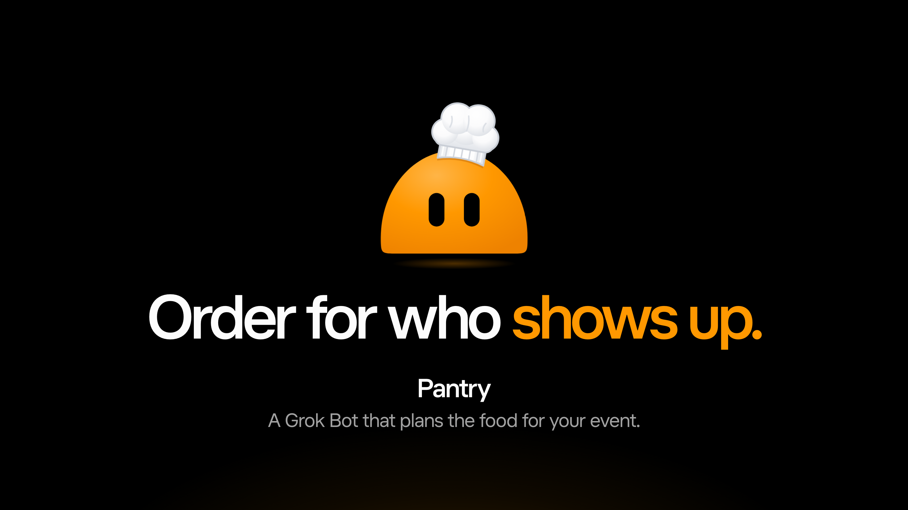

**Order for who shows up.** Pantry is a custom Grok Bot for people who run community events: meetups, hackathons, socials. It plans the catering for the people who actually turn up. Its job is safe, on budget, on time, and nothing in the bin.

It isn't an app. You talk to Pantry in Grok Bot (desktop, mobile, X DMs). It works through Grok Bot's real features: persona, skills, routines, its own email, a 1Password vault, payments and voice. Its hands are this repo's MCP server, and its long-term memory is Cognee.

## The demo video

A two-minute film of the whole demo, cut to an original 120 BPM score: the deck's story, then Pantry's real Grok Bot chat doing the four prompts (Notion, Luma and Cognee, the plan, a card per meal, the brief by email, a £70 deposit on a single-use Agentcard in sandbox), with animated explainers beside the chat, and the wrap. It's narrated in ElevenLabs' "Lily", with no subtitles. How it was made, what's sped up and what's hidden, and how to re-cut it: [`story/VIDEO.md`](story/VIDEO.md).

## The problem

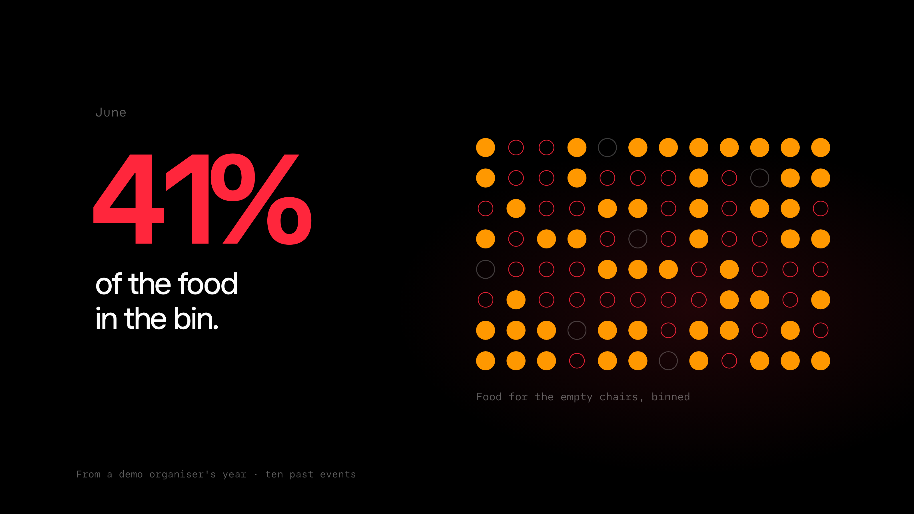

Organisers order for who signs up. Then half the room doesn't come, the food for the empty chairs goes in the bin, and the coeliac guest still has nothing safe to eat. (The numbers on the deck come from the demo organiser's ten past events in `data/events/archive/`.)

## What it does

1. **Who's coming.** Reads the Luma guest export: sign-ups and what guests declared about diet. It forecasts turnout from the organiser's past events (check-ins vs sign-ups). Allergies and coeliac are planned at 100%, whatever the forecast.
2. **What to serve.** Compares supermarkets (Sainsbury's, Waitrose, M&S), event caterers and restaurants. An option is out if any guest with a declared need would go without a safe plate, if it breaks the budget, if it can't land in time, or if it doesn't deliver to the venue's area. The rest are ranked on rating, punctuality, cost per expected guest, and what ran out before.
3. **Logistics.** The food lands 45 minutes before serving, or earlier if the venue says so. Pantry reads the venue's email and catches a quote that would miss the cut-off.
4. **Brief and pay.** It drafts the brief for the provider. Payment, in full or the deposit a caterer asks for, waits for the organiser's yes in Grok Bot, then goes on a single-use Agentcard for exactly that amount. Pantry can't approve, pay, send or file anything by itself.
5. **After.** A debrief updates the show rate and the provider ledger. Lanes that ran out get a buffer next time, and providers that ran late get an earlier drop.

```
npm test                              # 78 tests, zero dependencies (Node 20+)
node src/cli.js event headcount       # 140 signed up → plan for 93
node src/cli.js event options         # every provider, and why each is in or out
node src/cli.js event plan            # plates by lane, cost, logistics
node src/cli.js event inbox           # Pantry's own inbox, triaged
node src/cli.js event cards dish      # every meal of the plan as a PNG card
npm run mcp                           # the bot's MCP tool server (stdio)
```

## Architecture

<p align="center">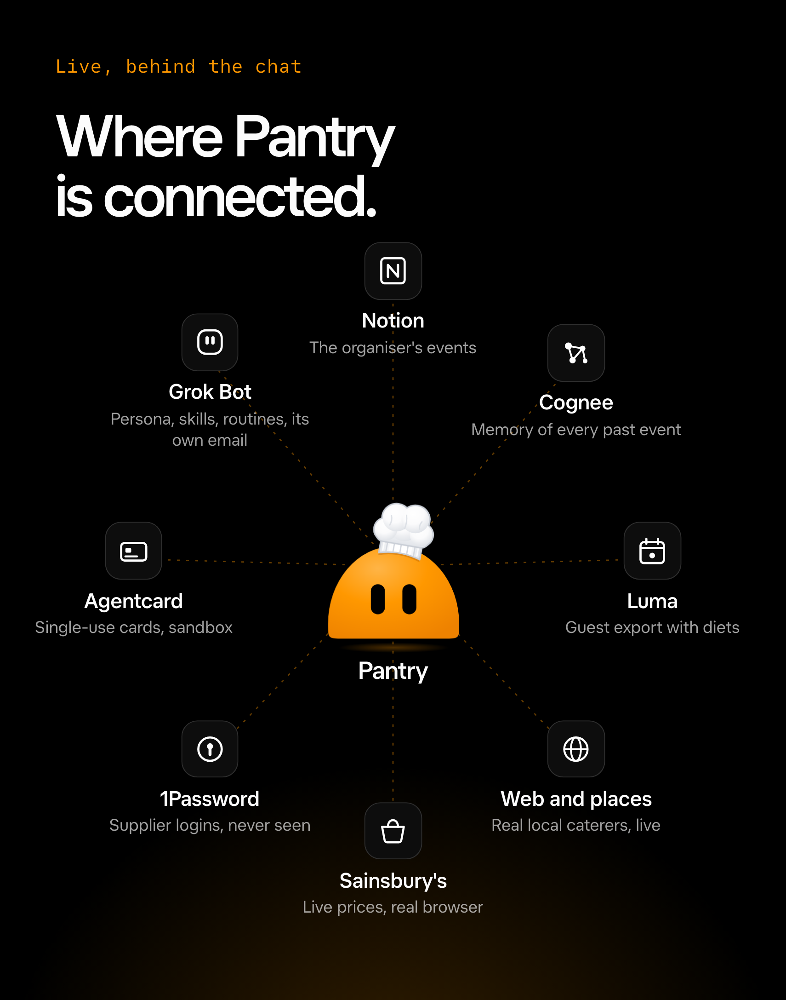 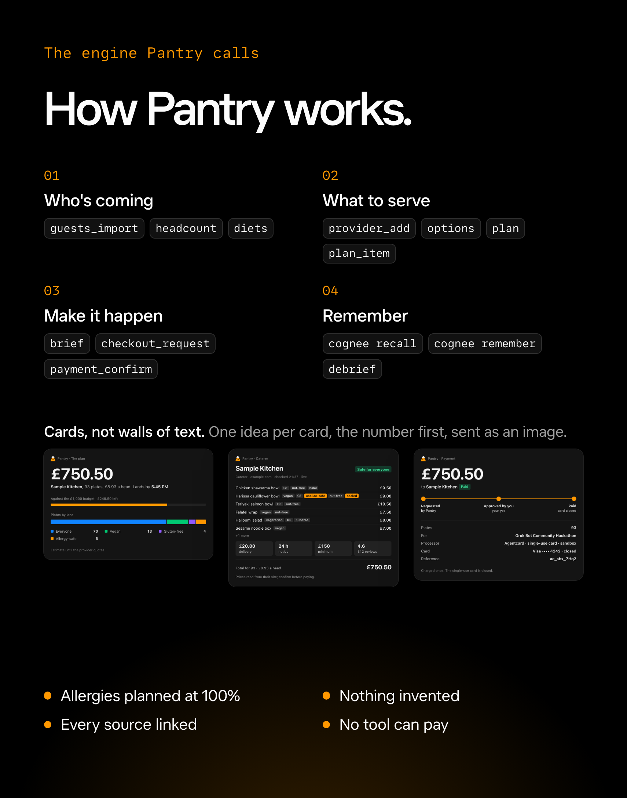</p>

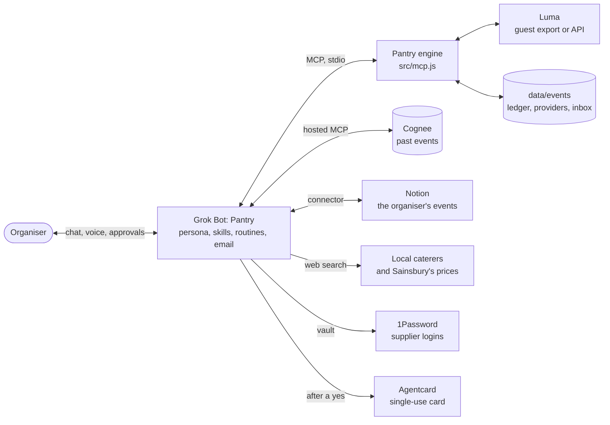

The engine (`src/events/`) does the arithmetic: turnout, lanes, filters, ranking, the plan hash a payment is bound to. Grok Bot does the talking, the searching and the sending. The MCP server exposes the engine's event tools, and none of them can approve, pay, send or file.

| Piece | How it's real |
|---|---|
| **Grok Bot** | `bot/persona.md` (under the 4,000-character limit), twelve skills in `bot/skills/`, the event countdown routine, and the profile (dome character in a chef's hat, yellow, voice). Setup steps with checks: `bot/SETUP.md` |
| **Engine** | `src/events/`: Luma import, turnout forecast, diet matrix, provider options, plan, brief, approval, debrief and ledger. Served to the bot by `src/mcp.js` |
| **Luma** | Grok Bot has no Luma connector. Pantry reads Luma's guest CSV export, which works on any plan. With Luma Plus it reads the public API instead (`src/events/luma-api.js`; the key is stored as a Grok Bot secret) |
| **Cognee** | The memory of past events: guest exports, quotes, invoices and debriefs as a knowledge graph in Cognee Cloud. The bot connects to Cognee's hosted MCP. The engine does the arithmetic; Cognee answers "what happened, and why" |
| **Notion** | The organiser's events and the upcoming guest list |
| **Payments** | Agentcard, sandbox for the demo: after the organiser's yes, `scripts/agentcard-pay.mjs` makes one single-use card for exactly the approved amount (£ to $ at the ECB rate), charges it once and checks it closed; it refuses live credentials. Sandbox test cards hold up to $100, so the demo pays the £70 deposit that holds the date. Flow in `bot/skills/07-pay.md` |
| **1Password** | Supplier logins come from the vault "Shared with Grok Bot". Pantry never sees them |

## How it pays

<p align="center">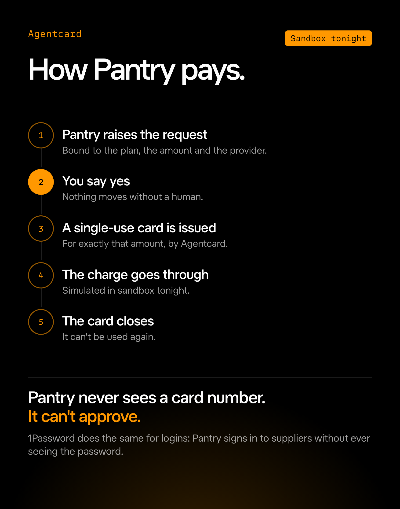</p>

The approval is bound to the plan hash, the amount and the provider. If the plan changes, the approval is void.

## Design

Grok Bot gives this bot no Visualize tool, so Pantry's answers come back as cards: the engine renders them itself (`event card <kind>`, or `event cards dish` for every meal at once) with a headless Chrome over the DevTools protocol, and Pantry posts the PNG (spec: `scripts/card-png.md`). One idea per card, the number first.

| | |
|---|---|
| 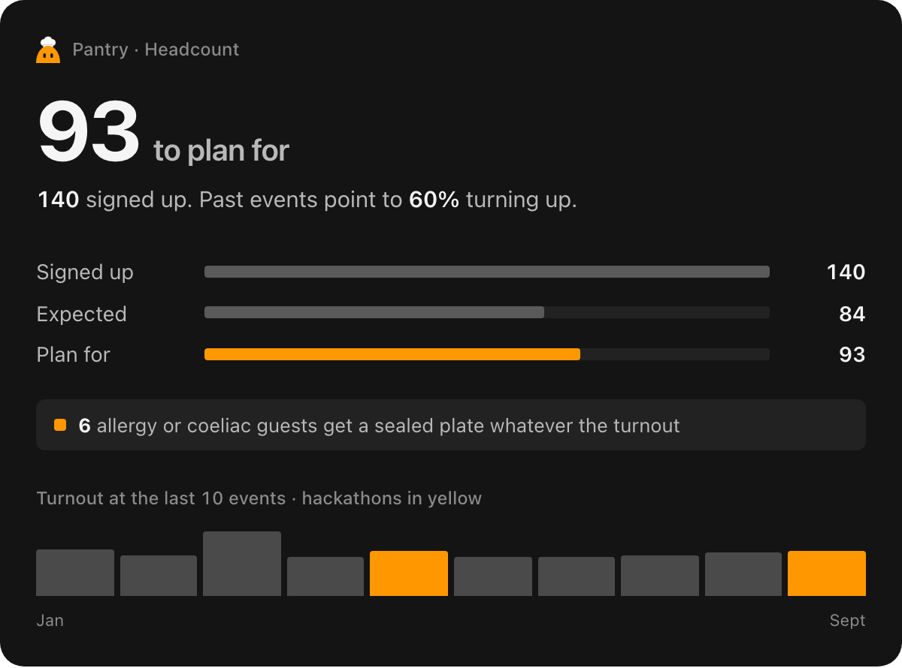 | 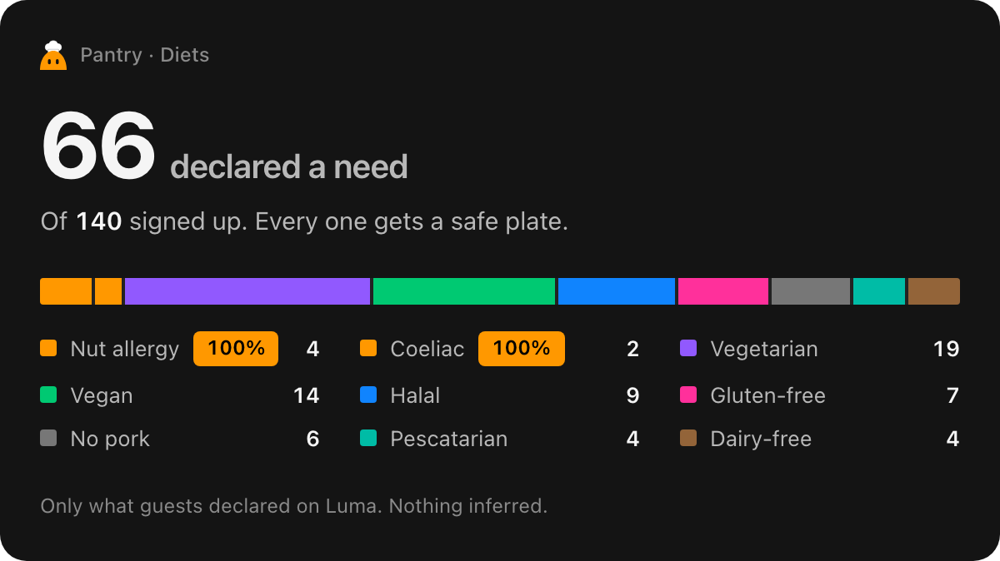 |
| 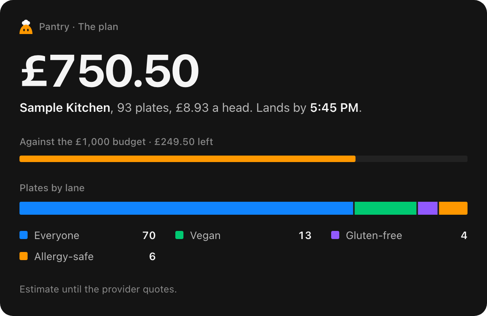 | 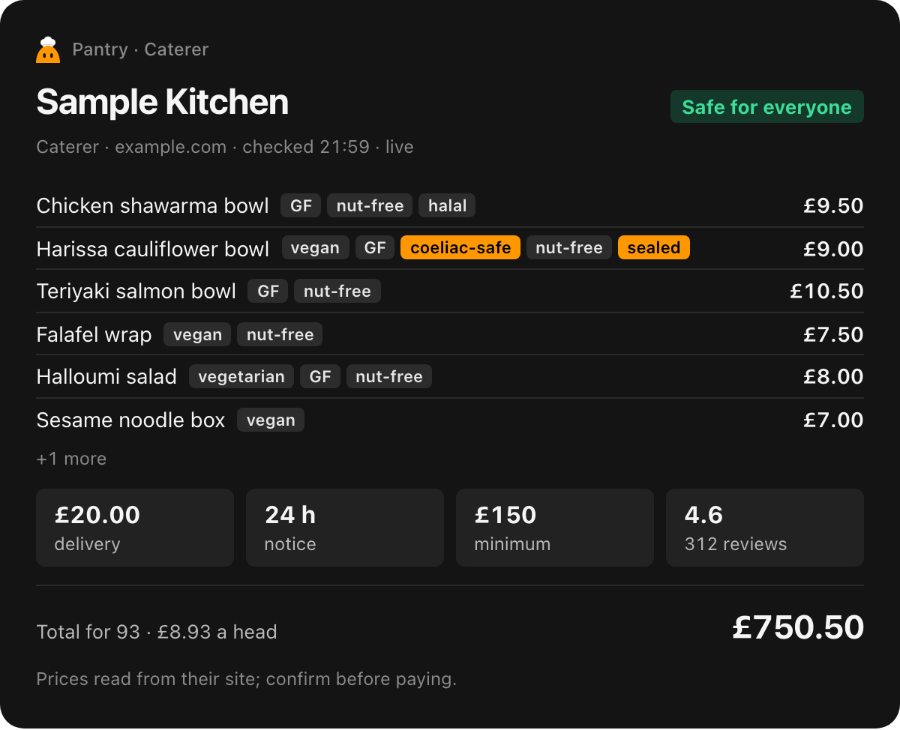 |
| 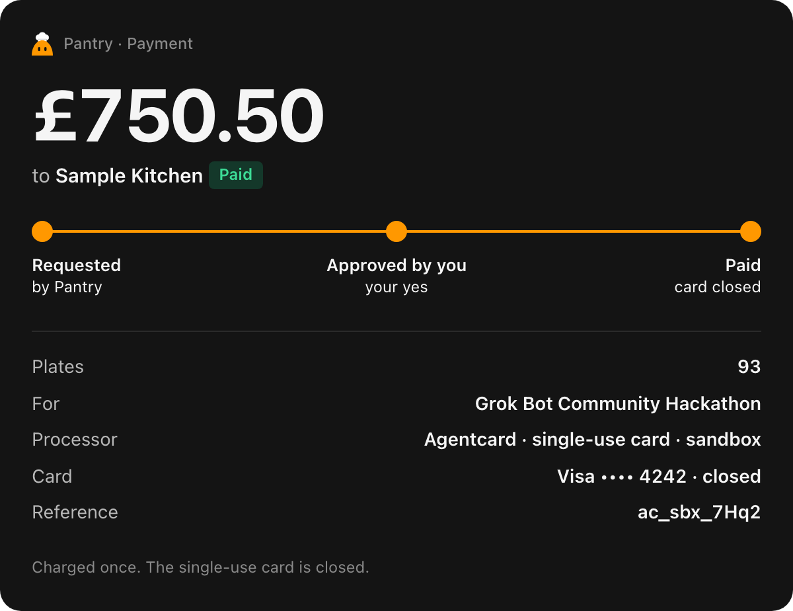 | 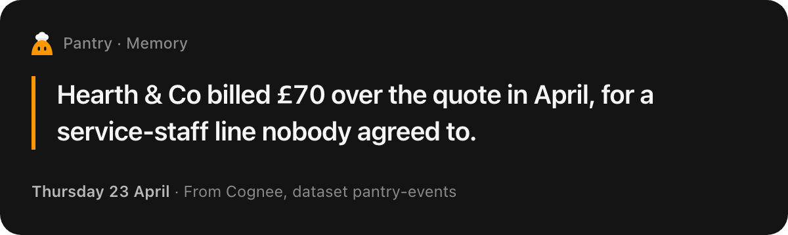 |

- **Cards:** always dark, 600 px wide, an 8 px grid, tabular numerals, and a CSS-only entrance that lands by 1.2 s. Every card kind, in both Grok themes: `story/cards-preview.html` (`node scripts/cards-preview.js`).
- **The character:** Grok Bot's dome shape in Pantry's yellow (#FF9800), with a chef's hat drawn for Pantry. Files: `bot/assets/pantry-avatar.svg` and `.png`.
- **The stage deck:** `story/index.html`, driven by a Stream Deck during the live demo. The run of show is in `story/SCRIPT.md`.

The card images above come from the engine's sample data, the same as `cards-preview.js` (the "Sample Kitchen" caterer is a placeholder).

## What's real, what's dummy

- **Dummy data:** the organiser's ten past events (`data/events/archive/`) and tonight's guest list. Guests, names and emails are made up.
- **Providers:** supermarket brands are real, but their prices are estimates. The caterers and restaurants (Little Feast, Hearth & Co, Mezze Collective, Slice Theory, Bao Down) are fictional examples.
- **Diets:** they come only from what guests declare. Pantry never profiles anyone from X or anywhere else, and it talks about guests in aggregate.

The original household version (the weekly Sainsbury's shop and its app in `web/`) is still in the repo for reference. Progress and open items are in [`TASKS.md`](TASKS.md).
